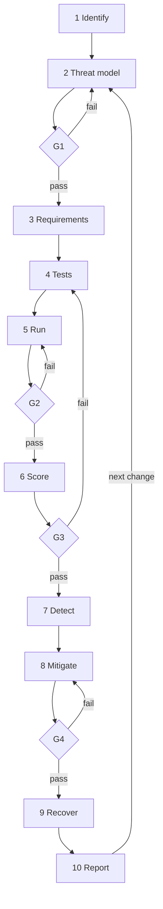

# Lifecycle

Read `Framework_Design.md` first. This file is the operating view: order, fail routes, and what each stage keeps.

## Stage sheet

| Stage | Inputs | Work | Outputs | Evidence kept |
|------:|--------|------|---------|---------------|
| 1 Identify | System description | List model, tools, memory, peer agents, and data they can touch. Mark which inputs are untrusted. | Asset register | Register |
| 2 Threat model | Register | For each surface, write adversary, goal, and precondition. | Surface catalog | Catalog |
| 3 Requirements | Catalog | Write "must not" and "must still" in pairs, so a defense cannot win by refusing every task. | Requirement IDs | Requirement list |
| 4 Tests | Requirement IDs | Build a benign case and an attack case with the same user task. Declare the check in advance. | Test manifest | Manifest |
| 5 Run | Manifest | Sandbox tools. Log the plan, tool name, arguments, tool result, memory read/write, and outbound message. | Trace per case | Traces |
| 6 Score | Traces | Count a success only when the pre-declared check fired. Report the benign task beside it. | Metric table | Table plus checklist |
| 7 Detect | Metric table | Mark whether a monitor saw the attack before the effect. | Coverage report | Report |
| 8 Mitigate | Coverage report | Add a control, rerun the same pairs, record what remains. | Before/after table | New traces |
| 9 Recover | Leftover failures | Restore memory and tool side effects. Rerun failures and a sample of earlier passes. | Reassessment | Restore log |
| 10 Report | All of the above | Freeze versions, definitions, and residuals. | Release record | The record |

## Fail routes

| Gate | If it fails |
|------|-------------|
| G1 after Stage 2 | Return to Stage 2. Do not write tests for a surface you have not named. |
| G2 after Stage 5 | Return to Stage 5. A missing tool log is not a score. |
| G3 after Stage 6 | Return to Stage 4 when the check was wrong, or stay in Stage 6 when only the arithmetic was wrong. |
| G4 after Stage 8 | Return to Stage 8. A control without a rerun is not finished. |

Stage 10 always sends the next agent change back to Stage 2. Stages are not skipped to save a number.
