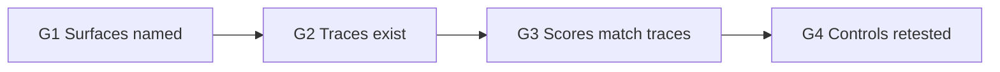

# Stage gates

A gate is a pass/fail check. A waiver is written in Stage 10. A waiver is not a pass.

| Gate | After | Pass | Fail |
|------|-------|------|------|
| G1 | Stage 2 | Tools, memory, and other agents are each covered or waived in writing | Back to Stage 2 |
| G2 | Stage 5 | Every case has a trace with tool boundaries, or a recorded run failure | Back to Stage 5 |
| G3 | Stage 6 | Every number points at a trace field and a requirement ID | Back to Stage 4 or Stage 6 |
| G4 | Stage 8 | Every control has a class, the IDs it covers, the task-success change, and the leftovers | Back to Stage 8 |

